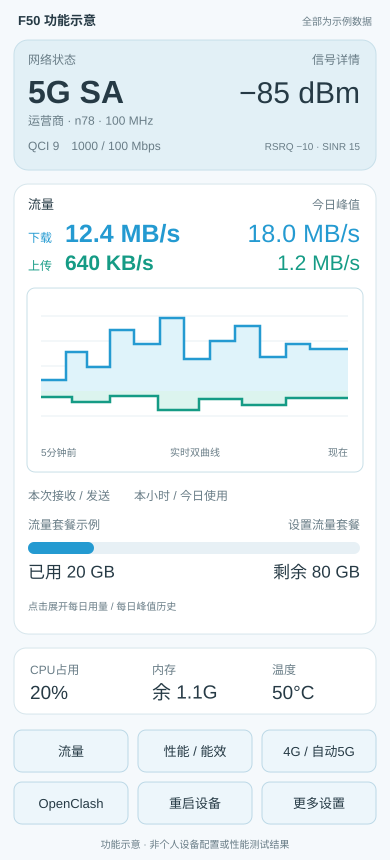

# F50 功能目录

**选你需要的功能，再交给 codex 配置。** 每个功能都有单独页面，说明它做什么、怎么配置、依赖、验收和恢复方法。

```text
请按 https://github.com/hanxi-p/F50-OpenWrt-Dashboard 配置我的 F50。
我选择的功能ID：live-chart、daily-peaks、plan、minute-log、error-log。（按我的选择修改）
先读取 features.json 中这些条目及对应功能页、AGENTS.md、风险和修复记录，识别设备版本与现有配置。
先列出所选功能的依赖、会一并安装/配置的范围，再按我的选择推进；已有基础包只核对差异，不清空历史。
保留密码、SSID、套餐校准、订阅及插件原状态；软件由电脑独立网络下载，通过USB管理F50。
记录本机选择清单和进度；分别检查明显错误、逻辑与多轮场景，未测写明，最后交付恢复入口。
```

复制下面需要的条目或功能ID给codex，也可参考[选择清单](selection.example.json)。**选择用于确定配置与验收目标**：界面功能共用[面板基础包](docs/install.md)，短信邮件和系统组件分别部署，管理、代理等可选配置按使用者提供的选项准备。

每项配置使用自己的设备和参数：可以选择后台免密、SSH密钥、会话时长、短信邮件、代理配置与兼容性修补。公开页面提供功能和操作方法，实际名单、凭据、密钥及配置记录留在自己的本机和设备。

## 功能目录

### 界面与设备

- [ ] **[手机与桌面布局](docs/features/mobile-layout.md)** `mobile-layout`
  常用信息常显，详情按需展开，手机按钮每行3个。
- [ ] **[信号与网络质量](docs/features/signal.md)** `signal`
  制式、运营商、频段、QCI和信号读数集中展示。
- [ ] **[基站、小区与SIM详情](docs/features/cell-details.md)** `cell-details`
  需要时展开查看基站、小区、地址与手机号。
- [ ] **[CPU总负载与逐核心详情](docs/features/cpu.md)** `cpu`
  总占用常显，点开查看8个核心占用与频率。
- [ ] **[内存占用与余量](docs/features/memory.md)** `memory`
  显示占用百分比、剩余量和Linux可管理总量。
- [ ] **[四传感器温度](docs/features/temperature.md)** `temperature`
  大字号平均温度，框内列出四个传感器。

### 速率与历史

- [ ] **[实时下载/上传双曲线](docs/features/live-chart.md)** `live-chart`
  最近5分钟、约2秒采样，关掉网页也继续记录。
- [ ] **[每日下载/上传峰值](docs/features/daily-peaks.md)** `daily-peaks`
  今日峰值常显，点击展开30天峰值双曲线。

### 流量与套餐

- [ ] **[本次累计接收/发送](docs/features/session-usage.md)** `session-usage`
  分别显示当前蜂窝接口收到和发出的总字节数。
- [ ] **[本小时使用流量](docs/features/hourly-usage.md)** `hourly-usage`
  显示北京时间当前小时接收+发送合计。
- [ ] **[今日使用流量](docs/features/today-usage.md)** `today-usage`
  从北京时间0点累计到当前的接收+发送。
- [ ] **[套餐总量、已用和剩余](docs/features/plan.md)** `plan`
  自己填写套餐总量与已用，显示进度和剩余额度。
- [ ] **[每日用量折线](docs/features/daily-usage-chart.md)** `daily-usage-chart`
  点击本月总消耗，在首页展开最近30天。
- [ ] **[月度用量历史](docs/features/monthly-history.md)** `monthly-history`
  查看每月接收、发送和含校准的已用合计。

### 快捷控制

- [ ] **[蜂窝流量开关](docs/features/data-switch.md)** `data-switch`
  打开或关闭移动数据连接。
- [ ] **[性能/能效模式](docs/features/power-mode.md)** `power-mode`
  按需开关大核：性能全核，能效使用4个小核。
- [ ] **[4G/自动5G切换](docs/features/radio-mode.md)** `radio-mode`
  点击立即切换，倒计时只提示预计等待。
- [ ] **[OpenClash开关](docs/features/openclash.md)** `openclash`
  已装代理插件的异步启停与状态反馈。
- [ ] **[Wi-Fi热点开关](docs/features/wifi-switch.md)** `wifi-switch`
  更多设置内控制热点开关。
- [ ] **[AdGuard Home开关](docs/features/adguard.md)** `adguard`
  广告过滤服务独立启停，位于更多设置。
- [ ] **[自动/手动Wi-Fi信道](docs/features/channel.md)** `channel`
  按当前地区与驱动能力选择合法非DFS信道。
- [ ] **[制式与频段锁定](docs/features/band-lock.md)** `band-lock`
  在更多设置查看邻区并锁定制式/频段。
- [ ] **[重启调制解调器](docs/features/modem-restart.md)** `modem-restart`
  只重启蜂窝模块，保留本地管理入口。
- [ ] **[重启设备与二次确认](docs/features/device-restart.md)** `device-restart`
  防止误点导致整机重启。
- [ ] **[切换到Android](docs/features/android-switch.md)** `android-switch`
  更多设置中主动进入保留的原厂系统。

### 日志与排错

- [ ] **[每分钟流量日志](docs/features/minute-log.md)** `minute-log`
  每分钟记录下载/上传增量与合计，保留5GB。
- [ ] **[报错与操作日志](docs/features/error-log.md)** `error-log`
  保留操作结果、错误原因和故障上下文，容量5GB。
- [ ] **[DNS协调与恢复](docs/features/dns-recovery.md)** `dns-recovery`
  在代理、广告过滤和直连之间协调可用解析链。
- [ ] **[热点启动保护与恢复](docs/features/wifi-recovery.md)** `wifi-recovery`
  针对零BSSID、长期pending和异常热点提供保护。
- [ ] **[超时、锁与子进程清理](docs/features/bounded-control.md)** `bounded-control`
  避免控制任务无限等待、重复切换或留下孤儿任务。

### 独立扩展

- [ ] **[短信转发到邮件](docs/features/sms-email.md)** `sms-email`
  发送号码与完整短信原文转发到自己的邮箱。
- [ ] **[IPv6多前缀学习](docs/features/ipv6.md)** `ipv6`
  学习蜂窝前缀并撤回失效前缀。
- [ ] **[短信存储与接收守护](docs/features/sms-storage.md)** `sms-storage`
  短信保存后释放SIM空间，保持接收与写池串行。
- [ ] **[USB网络与防火墙适配](docs/features/usb-firewall.md)** `usb-firewall`
  修补RNDIS桥接顺序与厂商5.4的flowtable问题。
- [ ] **[更新与回滚互斥](docs/features/boot-rollback.md)** `boot-rollback`
  回滚恢复匹配模块，避免并发修改启动控制。

### 定向诊断

- [ ] **[无线失败命令追踪](docs/features/wireless-trace.md)** `wireless-trace`
  记录无线初始化究竟是哪条命令失败。

### 管理与可选配置

- [ ] **[指定设备后台免密](docs/features/trusted-login.md)** `trusted-login`
  选择允许免密进入后台的设备及Wi-Fi/USB范围。
- [ ] **[SSH密钥登录](docs/features/ssh-key.md)** `ssh-key`
  配置自己的SSH公钥授权与连接别名。
- [ ] **[后台会话时长](docs/features/session-timeout.md)** `session-timeout`
  单独设置后台会话期限，例如12小时。
- [ ] **[SMTP邮箱参数](docs/features/smtp.md)** `smtp`
  单独设置发件邮箱、SMTP/TLS、收件人与授权码。
- [ ] **[代理与订阅配置](docs/features/proxy-configuration.md)** `proxy-configuration`
  安装和导入自己的代理、订阅或规则，配置DNS与IPv6。
- [ ] **[RPC兼容性修补](docs/features/rpcd-compatibility.md)** `rpcd-compatibility`
  按系统构建和ABI选择RPC依赖库兼容修补。

## 配套文件与维护

- [面板基础包安装与恢复](docs/install.md) · [下载ZIP](https://github.com/hanxi-p/F50-OpenWrt-Dashboard/archive/refs/heads/main.zip)
- [日志目录、字段和读取命令](docs/operations.md) · [故障排查](docs/troubleshooting.md)
- [版本与交付范围](docs/compatibility.md) · [风险清单](docs/risk-register.md) · [修复记录](docs/fix-history.md)

当前面板包匹配mu300-linux `v2026.10.11`、OpenWrt `25.12.5`、厂商5.4内核与MU300/Aurora页面；其他版本先适配。

## 界面参考



图中使用示例数据展示功能布局，不包含个人设备配置，也不代表性能测试结果。

## 来源与更新

系统和原始MU300面板：[dikeckaan/mu300-linux](https://github.com/dikeckaan/mu300-linux)，感谢作者与[kanoqwq / Minikano](https://github.com/kanoqwq)等贡献者。功能扩展由[hanxi-p](https://github.com/hanxi-p)维护，[完整署名](CREDITS.md)与[许可](LICENSE.md)保留。

尚未安装系统，先使用[F50刷机指北](https://github.com/hanxi-p/F50-mu300-linux-guide)。这里按功能选择和配置；公开代码和截图不含私人凭据、原始日志或整机备份。
