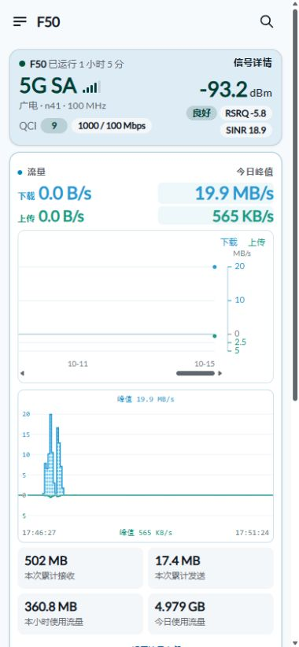

# F50 OpenWrt 面板与功能扩展

**手机上看清网络，点一下控制常用功能，关掉网页也能持续记录。**

面向 ZTE F50 / MU300 的 mu300-linux：首页布局、实时与历史曲线、流量套餐、快捷控制、短信邮件、日志和故障修补集中维护。由 [hanxi-p](https://github.com/hanxi-p) 从刷机指北第 11–13 章拆分。

## 交给 codex 执行

```text
请按 https://github.com/hanxi-p/F50-OpenWrt-Dashboard 为我的 F50 配置面板与功能。
先读 AGENTS.md、docs/risk-register.md、docs/fix-history.md、最近 docs/reviews/ 和 docs/11-optional-dashboard.md。
识别当前系统、内核、接口、插件、管理连接与已有数据；按版本条件准备依赖、代码和 SHA256。
先备份原文件和配置，再安装匹配的面板。保留密码、SSID、套餐额度、校准、历史数据及插件原状态。
电脑互联网走自己的主路由，USB 管理 F50；软件由电脑下载传入，不自动测速或消耗大量 SIM 流量。
以 docs/features.md 核对界面、统计、峰值、快捷按钮与日志；短信邮件、代理、广告过滤仅按我选定的项目配置，不导入他人的凭据。
先回归 P0，再检查受影响项：明显错误、并发/锁/超时/恢复逻辑、多轮场景测试分别记录。
可逆真实开关至少三轮往返后恢复初始状态；缺少手机、弱信号、冷启动等条件写明未测。
把进度和证据保存到本机 F50-progress.md，保存回退命令；实际浏览器确认手机与桌面布局后交付。
```

尚未刷入系统？先看 **[F50 刷入 mu300-linux 实操指北](https://github.com/hanxi-p/F50-mu300-linux-guide)**。系统与驱动来自 **[dikeckaan/mu300-linux](https://github.com/dikeckaan/mu300-linux)**；本项目在其 MU300 LuCI 面板上扩展，保留作者署名与许可。

## 功能一览

### 一眼看清网络与设备

- **信号卡片**：4G / 5G SA、运营商简称、频段与带宽、QCI、网络下发的上下行速率上限、RSRP / RSRQ / SINR。
- **设备负载**：CPU 总占用常显，点击展开各核心占用与频率；内存显示占用、剩余与总量。
- **温度**：四传感器平均读数大字号显示，框内列出 SoC、CPU、调制解调器、主板详情。
- **按需详情**：基站、小区、注册、SIM 提供的手机号，以及无线、LAN、租约与设备参数折叠查看。

### 四类曲线，把现在和历史放在一起

| 曲线 | 展示与入口 | 采集 / 保留 |
| --- | --- | --- |
| 实时速率 | 白底，上方天蓝下载、下方青绿上传；共同比例尺、动态纵轴、两侧时间与双峰值 | 后台约2秒采样，展示最近5分钟；关网页继续采集 |
| 每日速度峰值 | 点击“今日峰值”或峰值数字，在首页展开；上下分开、右侧纵轴、超宽横滑 | 后台100天，展示30天；每10秒汇总已有样本 |
| 每日流量 | 点击“本月总消耗”展开30天折线；日用量数字与日期同图 | 来自蜂窝接收+发送；页面内展开，不跳子界面 |
| 月度历史 | 点击月份，查看接收、发送及含校准的已用合计 | 数据库存于 SD；套餐校准与原始计数分开 |

### 套餐与用量

依次展示 **本次累计接收 / 发送、本小时使用、今日使用、本月总消耗与剩余**。今日从北京时间0点累计；本月套餐总量由自己填写，不限定为某个数值。

只有“设置流量套餐”修改配置：仅改总量不重置已用，编辑已用后从校准值继续累计；每月1日切换月份，总量沿用，历史保留。统计蜂窝口 `sipa_eth0`，包含路由器自身流量；不把 Wi-Fi 与 USB 转发重复加一遍。套餐账单与路由器计数分开对照。

### 六个快捷控制

手机每行3个，桌面同顺序一行展示：

| 流量 | 性能 / 能效 | 4G / 自动5G |
| --- | --- | --- |
| 蜂窝数据开关 | 手动开启或关闭大核；不启用自动休眠 | 点击立即切换，30秒提示倒计时，联网就绪提前结束 |
| **OpenClash** | **重启设备** | **更多设置** |
| 状态读取、异步开关和错误反馈；需先自行安装插件 | 二次确认后执行 | 蓝灰展开区域，Wi-Fi、AdGuard Home、信道、调制解调器、Android 与锁频段 |

开关开启/关闭使用填充/描边；性能红、能效绿，自动5G蓝、4G绿。切换显示实际目标与进度，无响应时不冒充“正在切换”。“更多设置”内保留保存并应用、保存与复位；关闭 Wi-Fi、重启设备、切 Android 需确认。

插件开关用于已有安装，不会自动下载代理核心、导入订阅或安装广告规则。DNS 链、四组合检查与故障恢复见 [功能详解](docs/features.md) 和 [第十一章 Q&A](docs/11-optional-dashboard.md)。

### 两类日志，各 5 GB

- **分钟流量日志**：每分钟记录原始接收/发送、区间增量与合计，并附启动编号、接口编号、运行时间；重启、计数下降和采样间断单独标记。
- **报错与操作日志**：开关目标、结果、耗时、错误原因、重要系统日志与失败时状态；保留内核故障上下文。
- **按容量保留**：两类各5GB，不按天数过期，满后清理最旧记录；错误日志分片轮转，避免只留“上一份”。

目录、字段、读取命令、容量边界与恢复方法见 **[日志与维护](docs/operations.md)**。原始日志是私有数据，不上传本仓库。

### 短信邮件与故障修补

新短信可转为邮件：主题“来自F50新信息”，正文包含发送号码与完整短信；持久队列、失败重试、去重与漏入队补偿。授权码由使用者私有配置，见 [第十二章](docs/12-optional-features.md)。

DNS 协调、弱信号下控制限时、锁与子进程清理、非 DFS 信道筛选、有效 BSSID 检查、IPv6 多前缀与短信存储等内容，按包与版本分别提供。问题、措施、证据与未解决项见 [第十三章](docs/13-optional-repair-and-optimization.md)、[风险清单](docs/risk-register.md) 和 [修复历史](docs/fix-history.md)。

## 手机效果



这是实际页面截图，读数来自截图时刻。完整布局与更多设置参考图见 [第十一章](docs/11-optional-dashboard.md)；每台设备展示自己的数据。

## 下载与安装

**适配基线：mu300-linux `v2026.10.11`、OpenWrt `25.12.5`、厂商 `5.4` 内核、MU300 / Aurora 面板、`sipa_eth0`、5GHz `radio0 / ap0`。** 版本不同先比对文件与接口，安装器不直接覆盖不匹配系统。

```powershell
git clone https://github.com/hanxi-p/F50-OpenWrt-Dashboard.git
cd F50-OpenWrt-Dashboard
# 先按第十一章检查版本、依赖和 SSH；f50 是自己的 SSH Host。
python .\extras\dashboard\deploy.py --host f50
```

也可 [下载 main ZIP](https://github.com/hanxi-p/F50-OpenWrt-Dashboard/archive/refs/heads/main.zip)，解压后从仓库根目录执行。安装器验证 SHA256，备份原文件并打印恢复入口；浏览器重新登录和刷新。

| 需要什么 | 入口 |
| --- | --- |
| 面板完整安装、依赖、恢复与Q&A | [第十一章](docs/11-optional-dashboard.md)、[dashboard 配套文件](extras/dashboard/) |
| 短信转邮件 | [第十二章](docs/12-optional-features.md)、[sms-email](extras/sms-email/README.md) |
| 系统稳定性组件 | [system-reliability](extras/system-reliability/README.md)；单独版本检查与安装 |
| 功能与数据口径 | [features.md](docs/features.md) |
| 日志、排错、日常维护 | [operations.md](docs/operations.md) |
| 更新边界和验收 | [兼容与交付范围](docs/compatibility.md)、[风险清单](docs/risk-register.md) |

当前设备的 MAC 定向免密、个人 SSH 密钥、SMTP/代理配置和 rpcd 私有库属于单独配置；不能把它们视为运行首页安装器后自动具备的功能。包内交付与定向配置的区别见 [兼容与交付范围](docs/compatibility.md)。

## 更新与来源

- **面板 / 扩展最新版本**：本仓库 `main`、[修改记录](docs/fix-history.md)。
- **刷机与切换系统**：[F50-mu300-linux-guide](https://github.com/hanxi-p/F50-mu300-linux-guide)。旧第11–13章地址继续指向这里。
- **原生系统 / 内核 / 安装器**：[dikeckaan/mu300-linux](https://github.com/dikeckaan/mu300-linux)，感谢作者与 [kanoqwq / Minikano](https://github.com/kanoqwq) 等上游贡献者。
- **署名和许可**：[CREDITS](CREDITS.md)、[文档许可](LICENSE.md)、[面板代码 MIT](extras/dashboard/LICENSE)。

本仓库发布代码、文档、校验与公开效果图；设备完整备份、凭据和原始日志留在使用者的本地或私有存储。
