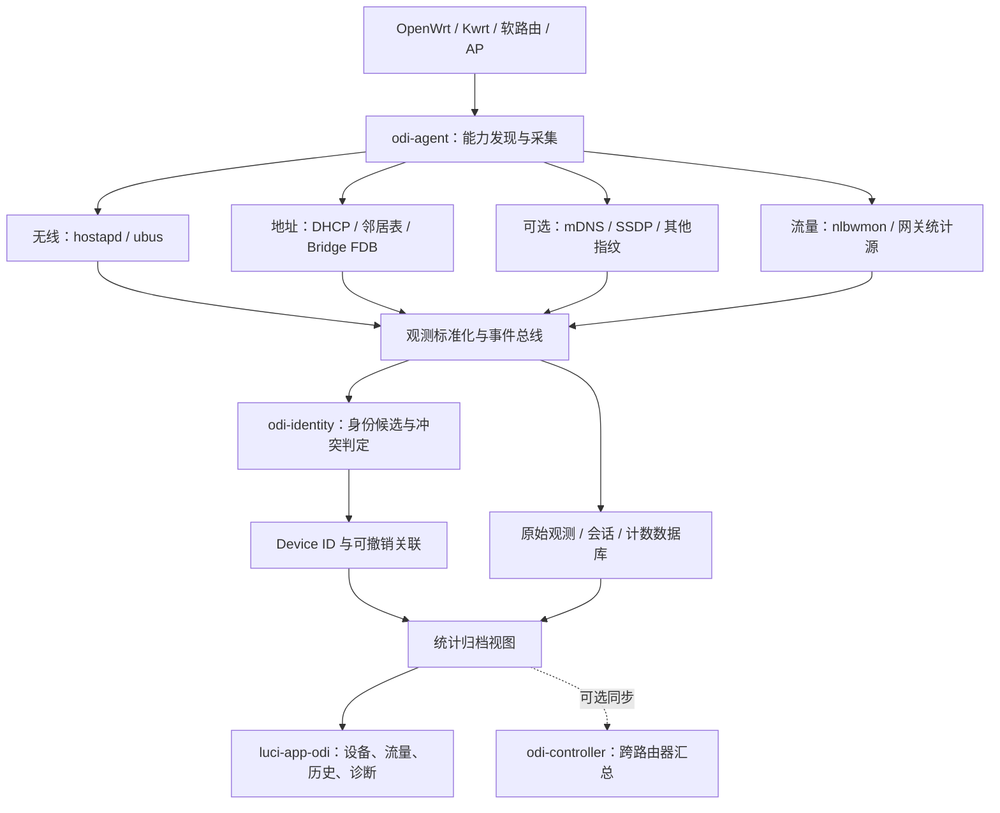

> 实施状态以同目录的 PROGRESS.md 为准。本文件是目标方案，样例不等于本项目实测通过。

# ODI：OpenWrt 通用智能设备识别与网络统计系统

> **ODI — OpenWrt Device Intelligence**<br>
> **文档类型：产品与技术实施方案（整合版）**<br>
> **版本：V2.0 · 2026-11-01**<br>
> **目标平台：OpenWrt / Kwrt 及兼容衍生系统**<br>
> **产品形态：独立运行的 OpenWrt 插件 + 可选多路由器控制器**

---

## 0. 执行摘要

ODI 的核心目标是：**在不改变用户连接 Wi-Fi 的习惯、无需修改 SSID/密码/加密方式、无需安装客户端的前提下，为联网设备建立尽可能稳定、可追溯的档案，持续统计流量、连接时间和网络质量。**

解决的问题不只是“MAC 变化后设备名称丢失”，而是当前路由系统常把 **网络地址、网络会话和真实设备身份** 混为一谈。ODI 将它们拆成三个层次：

1. **观测（Observation）**：路由器在某个时刻看到某个 MAC/IP/无线能力/协议特征。
2. **身份关联（Identity Link）**：这些观测可能来自同一台设备，关联有证据、置信等级、有效期和撤销能力。
3. **设备档案（Device Profile）**：用户可长期查看的名称、类型、历史流量、连接时间与诊断记录，以永久 `device_id` 为主键。

方案采用 **“采集插件化 + 指纹多维化 + 关联可解释 + 原始数据不丢失 + 统计口径明确”** 的路线。现有成熟组件用于承担已解决的部分；自研集中在跨随机 MAC 身份归档和用户体验上。

**重要技术边界：** 随机 MAC、生效的隐私机制、相同型号终端的相似指纹，决定了纯被动识别无法保证 100% 判断物理身份。ODI 不将猜测伪装成认证；在证据不足时保留独立账目，但允许界面智能折叠以减少干扰。

---

## 1. 需求背景与适用场景

### 1.1 真实问题

- iPhone、MacBook、iPad 等终端可能使用不同的私有 MAC；同一物理设备在路由器中出现多个历史条目。
- 部分设备没有 DHCP Hostname，或者 Hostname、IP、MAC 都会变化。
- 流量与连接时间按 MAC 分散记录，难以按长期使用的设备名称汇总。
- 用户不愿逐个手动认领设备，也不愿每台设备设置独立 Wi-Fi 密码、安装证书或插件。
- 需要兼容 **随身蜂窝路由器、普通固定 OpenWrt 无线路由器、有线软路由、纯 AP**，而非只适配一台 Kwrt。
- 多台 OpenWrt 后续可能共同工作，但单机部署必须完整可用。

### 1.2 接入方式与第一版策略

| 场景 | 默认识别策略 | 流量/连接时间统计范围 | 说明 |
|---|---|---|---|
| 2.4GHz IoT | 已知 MAC 优先，辅以名称/类型 | 本机可见的流量与 Wi-Fi 会话 | 对目前常见的固定 MAC 终端走简化路径；不假设所有 2.4GHz 均不随机化 |
| 5GHz/6GHz 手机、平板、电脑 | 无线能力 + DHCP/mDNS + 历史行为的多维指纹 | MAC 原始计数 + Device ID 汇总 | **核心研发方向** |
| 有线直连 | MAC、DHCP、服务信息、接口/桥信息 | 可观测的设备流量；在线时间可能需估算 | 不为有线链路套用无线指纹 |
| 下游交换机 / 桥接 AP | 主机可见则分别记录；不能确定拓扑则只标注来源 | 按可见终端统计 | 桥 FDB 只能证明 MAC 经某端口学习，不代表物理插口一对一 |
| 下游 NAT 路由器 | 只把下游路由器作为主路由可见的一台设备 | 统计下游路由器整体 | **不尝试拆分其 NAT 后面的物理终端** |
| 多 AP / 多路由器 | 本地观察 + 可选中心关联 | 避免漫游在线时长和流量双计 | 第二阶段支持 |

### 1.3 非目标

ODI 第一版**不做**：Wi-Fi 准入认证、强制门户、替换无线驱动、破解随机 MAC、识别用户浏览的具体内容、为 NAT 下游逐台设备分账、自动阻断未知设备。

---

## 2. 核心产品原则

1. **连接零改动**：不强迫修改 Wi-Fi 加密类型、SSID 或现有密码，不引入连接步骤。
2. **本地优先**：没有外网、控制器或云服务时，单机识别、统计、页面正常工作。
3. **能力探测而非设备型号硬编码**：启动时发现可用接口、hostapd 特性、WAN 角色、存储条件。
4. **身份与观测分离**：MAC/IP/SSID/接口不是永久物理身份。
5. **证据可解释**：展示“为什么怀疑是同一设备”和“有哪些反证”。
6. **统计可回算**：保存源数据及绑定历史，撤销误关联后能恢复统计。
7. **不乱合并**：自动合并以实测误合并风险为依据，优先精准而非高覆盖率。
8. **资源敏感**：适合低 Flash 随身 Wi-Fi，也允许软路由启用重型能力。
9. **不影响上网**：Agent、数据库或 UI 故障不影响主路由现有转发和认证。
10. **最小化采集**：优先使用路由器已有管理数据，不采集通信正文，不默认启用主动扫描或抓包。

---

## 3. 系统总架构



### 3.1 模块职责

| 模块 | 作用 | 是否必需 |
|---|---|---|
| `odi-agent` | 本地能力探测、采集、事件处理、存储管理 | 必需 |
| `odi-identity` | 指纹构建、候选排序、冲突检测、身份关联 | 必需 |
| `odi-stats` | 流量采样、连接会话、聚合与回算 | 必需 |
| `luci-app-odi` | LuCI 页面、设备名称、统计展示、纠错 | 推荐 |
| `odi-fp-*` | 可选 DHCP、mDNS、原始无线 IE 等指纹适配器 | 按能力启用 |
| `odi-controller` | 多机同步、跨 AP 身份与统计去重 | 后续可选 |

**不在路由器端强制引入 Docker、完整 OpenWISP 服务端或大型 DPI 引擎。**

### 3.2 单机与多机部署

- **单机模式**：Agent + 本地档案库 + LuCI；直接适配随身 Wi-Fi、家庭路由器。
- **多机模式**：每台路由器拥有唯一 `router_id`；属于同一网络管理域的节点共享 `site_id`，可选控制器汇总。
- **不同地点的独立路由器**：默认使用各自的 `site_id`，不因 MAC/指纹相同就直接共享物理设备身份。
- **同一地点多 AP**：允许关联同一设备的多节点会话，但需要处理漫游和重复统计。

---

## 4. 设备身份模型：ODI 的核心差异化能力

### 4.1 三层数据模型

**原始网络身份**（可能变化）：

- 当前 MAC、IPv4/IPv6、DHCP Client ID、接入 SSID、频段、端口、关联会话等。

**身份候选关系**（存在不确定性）：

- “新 MAC 可能是 DEV-001 的另一地址”；保存匹配证据、反证、评分、策略版本、发现时间。

**永久设备档案**（稳定）：

- `device_id`（UUID）、自定义名称、类型、首次发现、已确认标识、历史统计。

> 设备档案 ID 为系统内部稳定主键，不是路由器能从客户端直接读取的硬件序列号，也不是网络安全认证凭据。

### 4.2 关键数据表

| 表/实体 | 关键字段 | 目的 |
|---|---|---|
| `routers` | `router_id`, `site_id`, `role`, `capabilities` | 描述采集节点与网络角色 |
| `devices` | `device_id`, `site_id`, `display_name`, `device_type`, `created_at` | 物理设备档案 |
| `identifiers` | `identifier_id`, `device_id`, `kind`, `value`, `first_seen`, `last_seen`, `verified` | 历史 MAC/其他标识 |
| `observations` | `observation_id`, `router_id`, `mac`, `interface`, `timestamp`, `raw_ref` | 保留每次真实观测 |
| `fingerprints` | `observation_id`, `schema_version`, `radio_profile`, `network_profile` | 标准化特征与版本 |
| `identity_candidates` | `source_observation`, `target_device`, `evidence`, `conflicts`, `state` | 候选匹配和解释 |
| `identity_links` | `link_id`, `device_id`, `identifier_id`, `source`, `valid_from`, `valid_to`, `revoked_at` | 可撤销、可追溯的身份关联 |
| `sessions` | `session_id`, `router_id`, `mac`, `started_at`, `ended_at`, `end_reason`, `quality` | 连接时长 |
| `traffic_samples` | `router_id`, `mac`, `counter_source`, `scope`, `sampled_at`, `rx`, `tx` | 原始流量计数 |
| `daily_usage`（派生） | `device_id`, `date`, `scope`, `rx`, `tx`, `online_seconds` | 可重新计算的统计缓存 |

推荐 `device_id` 使用 UUID；对外展示可生成便于阅读的 `DEV-000123` 别名。标识匹配至少按 `site_id` 限定范围；同一个 MAC 在不同网络出现不等于同一物理设备。

### 4.3 示例档案

```yaml
device_id: "9d3e8d9d-0e39-4a9b-a06a-50efde0b8db0"
display_name: "我的 iPhone"
device_type: "phone"
site_id: "home"
identifiers:
  - type: mac
    value: "1e:cc:80:xx:xx:xx"
    verified: true
  - type: mac
    value: "82:8b:03:xx:xx:xx"
    verified: false
fingerprint_profiles:
  - band: "5GHz"
    schema_version: "wifi-fp-v1"
    observations: 4
identity_state: "known_with_candidate"
```

*以上仅为结构示例；第二个 MAC 并未被认定属于该 iPhone。*

---

## 5. 多维指纹识别：分层采集，而非简单 MAC 哈希

### 5.1 Wi-Fi 硬件能力（首要特征）

优先从已支持的 `hostapd.<iface> get_clients` 采集：

- HT/VHT/HE/EHT 标志（实际字段取决于驱动与版本）。
- VHT MCS Map、支持的空间流（NSS）、Beamforming 能力。
- `extended_capabilities` 原始数组。
- RRM、MFP、WMM 等能力。
- 可用时添加 Association Request IE、受支持速率集合、扩展管理 IE、厂商 IE。

**不要把实时速率、RSSI、AID、某次关联频率当作设备唯一指纹。** 这些受网络条件影响；可作为行为或诊断数据。

需要注意：

- `get_clients` 通常不能直接告诉你真实网卡芯片型号。
- 某些能力位依赖 AP、驱动、频段和协商上下文，应保留 `radio_profile` 用于归一化。
- 相同型号设备或相同 Wi-Fi 芯片常共享能力指纹。
- 低资源设备不强制启用 Monitor 模式或抓取管理帧。

### 5.2 DHCP / 网络协议指纹

采集优先级：

1. DHCP Hostname，剔除空名称、过度通用名称。
2. DHCP Vendor Class / 请求选项组合（需要相应采集能力，不能仅靠租约文件保证获得）。
3. DHCP Client ID（先检查是否只是 `01:MAC`；若是则不额外加权）。
4. mDNS 主机名、服务名称与服务类型（可观测时）。
5. SSDP 等服务信息（可选；不主动侵入设备）。

不要把同源信息计算为多条独立强证据。例如 Hostname 与 mDNS 名称可能共享同一个系统设备名；无线 MCS 与空间流也高度相关。

### 5.3 接入历史和反证

辅助判断：

- 旧 MAC 离线后，新 MAC 在合理时间窗口出现。
- 新旧观测是否来自同一 `site_id` 或相同无线网络。
- 有无同型号同指纹的其他活跃设备。
- 两个身份是否在互斥条件下同时在线。
- 同一设备是否出现多个合法接口或多频段行为（避免过度使用“同时在线”反证）。

**RSSI 相近、流量行为相似、相同操作系统**只能帮助排序，不能单独用于确定归属。

---

## 6. 自动关联算法与防误判策略

### 6.1 实施流程

```text
发现新观测（MAC、接口、时间）
    ↓
已知 MAC 且绑定无冲突？ ── 是 → 使用既有 Device ID
    │
    否
    ↓
按接入方式调用对应特征采集器
    ↓
从同一 Site 的历史设备中生成候选
    ↓
比对无线/网络指纹及连接上下文
    ↓
强制检查反证（并发冲突、特征不兼容、重复候选）
    ↓
得出：高可信候选 / 疑似候选 / 未知
    ↓
展示或保留关联，原始账目始终独立存储
```

### 6.2 匹配的两个阶段

**第一阶段：候选召回**

使用标准化指纹和已知信息缩小搜索范围。例如：相同 Wi-Fi 能力组、相同有区分度的主机名、同一站点的近期离线设备。

**第二阶段：风险判别**

对候选执行严格的冲突检查，结合独立信息源判断是否有足够证据。可用规则引擎实现，后续基于有标注的真实样本校准阈值。

不直接使用“某几项各加 20 分、达到 80 分就自动合并”的固定方案；未经验证的分数不能当作准确率。

### 6.3 关联等级

| 等级 | 典型条件 | 数据处理 |
|---|---|---|
| `known` 已知 | 已确认的历史标识命中，且无冲突 | 继续关联同一档案 |
| `candidate_high` 高可信候选 | 多源特征吻合、候选唯一、无重大反证 | 先在影子模式记录；满足经过实测验证的规则后才允许自动关联 |
| `candidate` 疑似 | 仅部分指纹相似或证据不足 | UI 可以折叠展示，但不合并账目 |
| `unknown` 未知 | 无可信候选或多个不可区分候选 | 独立记录，不阻断上网 |
| `conflict` 冲突 | 观察到难以解释的同时在线或特征矛盾 | 禁止自动合并，保留证据 |

### 6.4 解决“看起来有一堆设备”的用户体验

即使没有证据自动确认，也应提供：

- **当前活跃设备**和**历史网络身份**分开展示。
- 将同一个已确认档案下的多个 MAC 自动折叠。
- 对疑似重复档案只展示“可能属于 XX”，不强制逐条认领。
- 保留“忽略历史网络身份”“恢复显示”“批量清理展示”等非破坏性操作。
- 自定义名称优先显示；设备原始 Hostname 保留为辅助信息。

### 6.5 指纹学习与模型迭代

- 保存每次匹配的**特征版本**与匹配策略版本。
- 比较同一已知设备在不同连接中的稳定字段。
- 统计不同设备指纹碰撞频率，降低常见特征的权重。
- 系统升级后可重新计算候选关系。
- 允许导入人工核实的小规模标签集，验证误关联率。

**先实现可解释规则；只有拿到足够真实标注数据后才评估机器学习模型。**

---

## 7. 流量统计：源数据、归属与准确性

### 7.1 统计目标

至少提供：

- 实时流量速率（采样窗口内估算）。
- 今日、昨日、本周、本月上下行流量。
- 设备历史累计流量与日期曲线。
- 接入类型、设备组流量排行。
- 随身 Wi-Fi 的蜂窝套餐流量趋势（条件允许时）。

### 7.2 数据来源和限制

| 部署角色 | 优先统计来源 | 必须说明的口径 |
|---|---|---|
| 主网关 | `nlbwmon` / conntrack 等可用路径 | 统计范围、NAT、IPv6、多 WAN、offloading 影响 |
| 蜂窝 WAN 网关 | 网关计数 + 可用的 modem 流量计数 | 套餐口径须与实际 WAN/运营商统计核对 |
| 纯 AP | Wi-Fi 接口或驱动客户端字节计数 | 可能包含 LAN 流量，不等于互联网流量 |
| 桥接节点 | 可观察的端口/客户端计数 | 可能重复见到通过上游网关的相同流量 |
| NAT 下游 | 主路由所见下游路由器 | 不拆分隐藏的下游终端 |

**绝不能直接把 hostapd 的无线 `bytes.rx/tx` 当作蜂窝套餐流量。**

### 7.3 统计流水线

1. 定期采集计数器快照，记录 `source`、`scope`、`interface`、`timestamp`。
2. 与上一次有效快照计算增量；识别计数器重置、重启和周期切换。
3. 原始记录按路由器、可观察身份（MAC/IP）和计数来源保存。
4. 依据有效 `identity_links` 构造设备汇总视图。
5. 若撤销身份关联，只重新计算归属，不篡改原始采样。
6. 对缺失数据和不可信统计明确标识。

存在软件/硬件流量分载时，必须实测计数是否覆盖流量；否则不标榜“精确套餐计量”。

---

## 8. 连接时间与活动时间

### 8.1 Wi-Fi

- 优先使用 hostapd 的连接/断开事件。
- 事件不可用时由在线快照轮询兜底；识别精度标注为“估算”。
- 保存 `started_at`、`ended_at`、`router_id`、`interface`、`mac`、`end_reason`。
- 路由器断电或时钟异常时标记“异常结束”，不虚构精确下线时刻。
- 多 AP 漫游的连续会话按时间区间求并集，避免重复累计。

### 8.2 有线

对直连电脑、交换机和下游路由器：

- 可获取端口状态时，记录**端口链路时长**。
- 邻居表、DHCP 租约或流量活动只能推断**最近活跃**，不能证明一直在线。
- 没有可用物理链路证据时，不显示伪精确的“连接时长”。

### 8.3 对用户展示四种不同指标

| 指标 | 含义 |
|---|---|
| 关联时长 | 终端维持 Wi-Fi 关联的时间 |
| 端口时长 | 有线接口链路保持连接的时间 |
| 活跃时长 | 在定义的采样窗口内有可观测活动的累计时间 |
| 估算在线时长 | 由非连续观测推算，需展示不确定性 |

---

## 9. OpenWrt 实现与硬件兼容

### 9.1 统一接口适配器

启动时检测：

- OpenWrt/Kwrt 版本、CPU 架构、Flash/RAM 可用量。
- 是否有 hostapd ubus 接口及 `get_clients`、可用事件。
- 是否具备原始关联 IE / taxonomy 能力；没有则自动降级。
- DHCP 来自 dnsmasq 或其他组件，是否能获取选项元数据。
- 网络角色是网关、AP、桥接或混合模式。
- nlbwmon 可用性与流量来源质量。
- 数据库及外部存储是否可用。

**不在安装时更换 `wpad`、无线驱动或更改现有 Wi-Fi 加密配置。**

### 9.2 针对已验证的 Kwrt 样本

方案提供的样例描述（本项目尚未独立复核）：

- 2.4GHz AP：`wl0-ap0`。
- 5GHz AP：`wl1-ap0`。
- 5GHz `get_clients` 返回 HT/VHT/HE、MFP、RRM、Extended Capabilities、部分 VHT MCS/Beamforming。
- 5GHz 在线设备中无线特征存在可区分差异。
- 当前 `hostapd.wl1-ap0` 的 ubus 方法列表**没有 `get_sta_ies`**。
- DHCP 租约能获取 MAC、IP、Hostname 和 Client ID；部分 Client ID 只是 `01:MAC`，不是独立身份依据。
- 既有 DHCP 租约中的离线 MAC 不能单靠租约推断其当前在线或归属。

**原型优先直接复用这些已证明可采集的数据；不依赖不存在的 `signature` 字段。**

### 9.3 存储策略

- UCI：低频、持久配置。
- `/tmp` / 内存：当前在线状态和采集缓存。
- SQLite（资源允许时）：档案、关联、会话、原始统计和索引。
- 低 Flash：定期聚合、批量提交、保留期限、数据库检查点；可用外置存储时优先将长期历史写入外部存储。
- `procd` 托管后台服务，支持重启恢复与故障隔离。
- 不为每个无线帧实时写入数据库。

### 9.4 不同设备的能力降级

| 缺失能力 | 降级处理 |
|---|---|
| 无完整无线 IE | 使用 get_clients 可见的能力字段 |
| 无 mDNS | 使用无线、DHCP 和历史信息 |
| 无 Wi-Fi | 只运行有线采集器 |
| 无 nlbwmon | 关闭该统计源或使用经过验证的替代计数 |
| 无 SQLite 资源 | 采用有限历史记录或可选外部控制器 |
| 无 hostapd 事件 | 轮询，在线时间标为估算 |

---

## 10. LuCI 产品交互设计

### 10.1 首页：设备总览

默认展示“当前可见设备”，而非混杂所有历史 MAC：

| 展示字段 | 示例 |
|---|---|
| 名称 | 我的 iPhone |
| 接入 | 5GHz · 本机 AP |
| 状态 | 在线 |
| 今日流量 | 1.2 GB（注明 WAN 或无线口径） |
| 今日连接时间 | 3 小时 20 分 |
| 档案 | 已知 / 疑似 / 未知 |
| 历史标识 | 2 个 MAC（可展开） |

下方可折叠展示未识别历史身份和疑似重复记录，避免用户面对长长的 MAC 列表。

### 10.2 设备详情

- 永久 Device ID、别名、设备类型。
- 当前与历史 MAC、IP、Hostname。
- Wi-Fi 能力摘要和观察到的指纹差异。
- 今日/周/月/累计流量曲线。
- 上线、离线和漫游时间线。
- 关联依据与冲突、历史关联操作。
- 可选的网络质量诊断。

### 10.3 身份关联中心

以“少打扰”为核心：

- 高可信候选自动在 UI 中归组展示，显示“未确认”的状态。
- 管理员可以一次性确认多条关联，也可以忽略。
- 合并操作必须可撤销，撤销后自动重算历史汇总。
- 系统绝不因未认领而限制用户上网。

### 10.4 统计与诊断

- 设备流量排行榜。
- 连接/断开事件和在线日历。
- 频段、信号、协商速率与异常断线趋势。
- 数据完整性提示（例如“本日有 8 分钟统计缺口”）。
- 存储空间、采样延迟、Agent 健康状态。

---

## 11. 多路由器支持：先预留、后实现

### 11.1 身份域

- `router_id`：每个采集节点独有。
- `site_id`：同一网络管理域中的节点共享。
- `device_id`：在身份域内使用稳定 UUID。
- 不对不同 Site 的设备进行未经确认的跨站点追踪。

### 11.2 统计去重

- Wi-Fi 接入记录可来自 AP。
- 实际互联网流量优先来自出口网关。
- 同一数据包被 AP 和网关都看到时不能直接相加。
- 跨 AP 在线时长按会话时间区间合并。
- 控制器离线时节点独立采集、记录来源，恢复后增量同步。

### 11.3 可选控制器

`odi-controller` 只承担集中档案、同步、跨节点统计和高级分析。**不是 ODI 单机功能的前置条件。**

---

## 12. 复用已有成熟技术，但不让项目被它们限制

| 现有组件/项目 | 复用价值 | ODI 自己需要做的部分 |
|---|---|---|
| `hostapd` / `ubus` | 无线连接状态、部分能力与会话 | 统一采集格式、长期档案与身份关联 |
| `dnsmasq` / DHCP | 租约及可用的网络指纹 | 判断字段价值、剔除与 MAC 重复的标识 |
| `nlbwmon` | 网关侧可观测的分主机计数 | 日/月采样、Device ID 归属、统计回算与准确性标注 |
| OpenWrt UFP | 多维设备类型识别思路 | 将“设备类型”与“同一物理设备身份”分离 |
| Kismet | 无线管理特征与随机 MAC 关联思路 | 不依赖专门的监控网卡，利用已有 AP 观测；持久化可撤销关联 |
| NetAlertX | 资产档案、历史和交互设计参考 | 解决 MAC 轮换下的身份归属和低资源部署 |
| OpenWISP | 多 OpenWrt 节点管理、Agent/控制器模式参考 | 本地优先、无需中心服务器的身份与统计核心 |

**结论：不以“集成某个现成产品”为产品定义；以 ODI 自己的设备身份模型为主线，选择性借用成熟的底层能力。**

---

## 13. 开发路线图与交付物

### P0：跨设备能力基线与样本采集

**目标：** 证明相同采集协议可在不同 OpenWrt 设备上工作。

- 选取随身 Kwrt、固定无线路由器、纯 AP/有线软路由作为验证环境。
- 收集固件版本、接口、可用字段、资源、统计源。
- 保存脱敏指纹样本与设备接入历史。

**交付：** 能力矩阵、样本集、采集规范 v1。

### P1：通用采集与永久档案

- 实现 `odi-agent` 的无线、DHCP、有线观察适配器。
- 设备自动建档、永久 Device ID、UCI 配置和持久化存储。
- 打通基础 LuCI 设备列表。

**交付：** 单机可安装、能保留名称和历史观测的原型。

### P2：流量与连接会话

- 对接 nlbwmon 或适合设备角色的计数来源。
- 保存原始计数、会话、异常结束与统计质量。
- 提供日/月曲线和历史流量汇总。

**交付：** 数据可验证、重启后可恢复的统计服务。

### P3：指纹引擎与影子匹配

- 生成版本化无线/网络指纹。
- 候选召回、冲突检测、解释输出。
- 先做**影子模式**：运行识别但不自动修改真实关联。
- 用已核实身份的数据测试重连、跨 SSID、实际随机 MAC 变化、同型号碰撞。

**交付：** 候选匹配报告、误关联分析、可选自动规则白名单。

### P4：档案归属与产品体验

- 智能折叠疑似重复设备。
- 关联确认、撤销、历史回算。
- 设备详情、在线日历、网络质量、系统状态。
- 降低低端设备写盘和内存压力。

**交付：** 第一版可公开试用的 `odi-agent` + `luci-app-odi`。

### P5：多机同步与增强能力

- 可选 `odi-controller`、Router/Site 域。
- 跨 AP 会话、流量去重、同步恢复。
- 设备类型知识库、异常检测、API 和导出。

**交付：** 多节点版本。

### 推荐优先级

| 优先级 | 功能 |
|---|---|
| **P0 必需** | 无损原始观测、永久 Device ID、档案命名、连接会话、流量统计 |
| **P1 核心优势** | 多维指纹、候选关联、冲突检测、历史 MAC 整理、撤销与回算 |
| **P2 体验提升** | LuCI 仪表盘、流量趋势、在线日历、网络诊断 |
| **P3 扩展** | 多路由器协同、套餐分析、异常告警、智能自学习 |

---

## 14. 验证方法与验收标准

### 14.1 测试集设计

至少包含：

1. 同一终端连续多次重连，MAC 不变。
2. 同一终端真实地发生私有 MAC 变化（**不是人为假定**）。
3. 两台相同型号或相同指纹的设备同时连接。
4. DHCP Hostname 缺失、修改或重复。
5. 2.4GHz / 5GHz、不同 SSID 的同一设备（有实际证据时）。
6. 有线直连、桥接设备、下游 NAT 路由器。
7. 路由器断电、重启、时间同步异常。
8. 流量计数重置、月度切换、IPv6、可能的硬件 offloading。
9. 多 AP 漫游和跨节点重复计数（多机阶段）。

### 14.2 评价指标

| 指标 | 如何衡量 | 期望 |
|---|---|---|
| 错误合并率 | 误将两台物理设备归入同一档案的比例 | 优先尽量接近零 |
| 自动关联覆盖率 | 已核实的 MAC 变化中被正确关联的比例 | 在误合并风险可控的前提下提高 |
| 未知记录比例 | 没有足够身份依据的观测比例 | 可解释、逐步下降 |
| 流量偏差 | ODI 汇总与受信任的网关/WAN 计数对比 | 明确口径与误差 |
| 会话时间质量 | 真实事件覆盖率、缺失和估算时长 | 明确标识不确定性 |
| 资源开销 | CPU、内存、数据库大小、Flash 写入 | 不影响正常网络转发 |
| 恢复能力 | 断电/重启后档案和统计能否恢复 | 不丢失已持久化数据 |

**不提前声称 95% 或 99% 的物理身份识别准确率。** 必须先通过真实样本和人工核实的标签测量。

### 14.3 第一版验收门槛

- 不改变现有 Wi-Fi SSID、加密方式和密码。
- 不要求用户安装客户端或打开网页认证。
- 同一已确认档案的流量和会话可统一查询。
- 原始 MAC 数据可追溯，误关联可撤销。
- 不确定的关联不会造成无提示的账目混算。
- 支持至少三类 OpenWrt 部署环境的能力降级。
- Agent 异常时不影响上网。
- 不将 Wi-Fi 字节计数误标为精确套餐流量。

---

## 15. 后续可扩展能力

### 15.1 设备智能管理

- 设备厂商/型号/系统的概率分类与建议命名。
- “疑似重复设备”智能折叠、历史身份回放。
- 指纹版本比较和系统升级前后变化检测。
- 同一设备的多 SSID / 多 AP 接入时间线。
- 自定义分组、标签和统计周期。

### 15.2 流量与蜂窝套餐分析

- 每日/月度流量排行榜、预算提醒、套餐余量预测。
- 网关/WAN 实际计数校验与异常缺口提示。
- 多 WAN 的流量分摊和切换历史。
- 流量配额与限制（**单独模块，默认不开启；必须避免误识别导致错误限制**）。

### 15.3 Wi-Fi 质量分析

- RSSI、连接速率、无线信道与 airtime 趋势。
- 频繁断连终端排行。
- 可用时统计重传、丢包和漫游表现。
- 设备质量评分，明确区分性能问题与身份问题。

### 15.4 高级身份引擎

- 可用原始关联 IE 时扩展更完整的 Wi-Fi 指纹。
- 根据特征出现频率动态调整候选权重。
- 基于真实标注数据尝试统计学习模型。
- 保留“可解释规则”作为默认稳定路径。
- 面向多 AP 的协同候选识别和冲突检测。

### 15.5 开放与管理能力

- JSON API、Webhook、CSV/JSON 导出。
- 可选数据备份、节点同步、集中管理。
- 与 Home Assistant 等本地系统做事件集成（作为后续独立适配器）。
- 数据保留期限和删除/纠错操作。
- 可选远程告警；不上传用户通信正文。

---

## 16. 关键风险及工程边界

| 风险 | 应对方式 |
|---|---|
| 多个物理设备使用相同指纹 | 冲突检测、不确定时不合并 |
| MAC、Hostname、Client ID 一起变化 | 视为弱证据，允许保持未知 |
| 设备更换频段导致能力差异 | 按频段/AP 能力归一化，保存多个 Profile |
| 部分 OpenWrt 没有原始 IE 接口 | 使用现有 hostapd 字段，不修改 Wi-Fi 协议栈 |
| AP 端字节数与互联网流量不一致 | 统计口径分开标识，出口网关优先 |
| NAT 下游不可见 | 只将 NAT 路由器作为整体，不虚构子设备 |
| Flash 寿命与空间受限 | 缓存、批量落盘、历史保留期限、外置存储 |
| 历史关联误判 | 版本化关系、撤销、历史统计回算 |
| 多路由器重复计数 | 站点、来源、接口角色和统计区间去重 |
| 设备隐私 | 仅在受管理网络采集、最小化数据与权限控制 |

---

## 17. 工程落地建议

### 17.1 推荐项目结构

```text
odi/
├── agent/                       # 能力发现、采集和后台服务
│   ├── collectors/
│   │   ├── hostapd/
│   │   ├── dhcp/
│   │   ├── wired/
│   │   ├── mdns/
│   │   └── traffic/
│   ├── fingerprints/            # 特征抽取与归一化
│   ├── identity/                # 候选匹配、冲突判定、关联管理
│   ├── sessions/                # 在线会话与恢复
│   ├── usage/                   # 流量采样与汇总
│   └── storage/                 # SQLite / 轻量存储接口
├── luci-app-odi/                # LuCI 页面与 ACL
├── controller/                  # 后续可选多路由器控制器
├── packaging/openwrt/          # Makefile、procd、UCI 配置
├── tests/
│   ├── fixtures/               # 匿名化真实网络样本
│   ├── identity/               # 指纹稳定性与碰撞测试
│   ├── usage/                  # 统计重置与回算
│   └── compatibility/          # 多机型能力降级
└── docs/
```

### 17.2 最小实验先做什么

在已经提供真实 `get_clients` 数据的 Kwrt 上：

1. 保存现有四台 5GHz 设备的标准化能力特征。
2. 分别进行正常断开、重连并比较同一设备的能力稳定性。
3. 验证不同设备之间的指纹碰撞。
4. 通过 DHCP/服务信息补充候选区分。
5. 仅在出现**可证明的实际 MAC 变化样本**时验证跨 MAC 关联。
6. 同时在另一台固定 OpenWrt 上运行相同采集器，确认架构通用性。

**实验合格后先实现档案 + 流量 + 会话；最后再根据真实误判结果开放自动归属。**

---

## 18. 项目最终定位

ODI 不应被设计成“把 NetAlertX、OpenWISP、Kismet 装在一起”的拼装产品。

它有独立的核心价值：

> **把网络接口、地址、连接会话和真实设备档案分开，让 OpenWrt 在不改变联网体验的前提下，尽可能稳定、可信、可撤销地管理设备身份，并将流量、在线时间和网络状态统一归档。**

**最小可行产品**：单机 OpenWrt 可用的永久设备档案、分设备统计、连接历史与多维指纹候选关联。<br>
**长期产品方向**：兼容不同 OpenWrt 硬件、可选多路由器协同、具备自学习和网络质量分析能力的通用设备管理平台。

---

*本文件是设计与实施计划，不表示其中所有接口在任意 OpenWrt 固件上已实现。需要通过 P0 能力探测和实测建立支持矩阵。*
